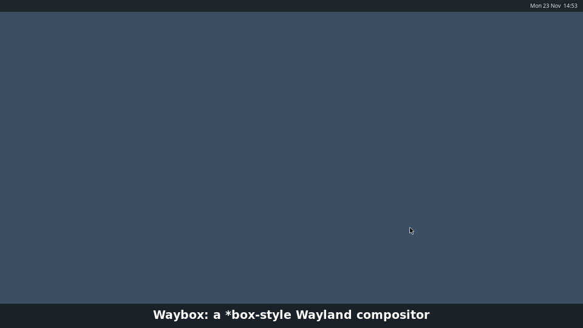
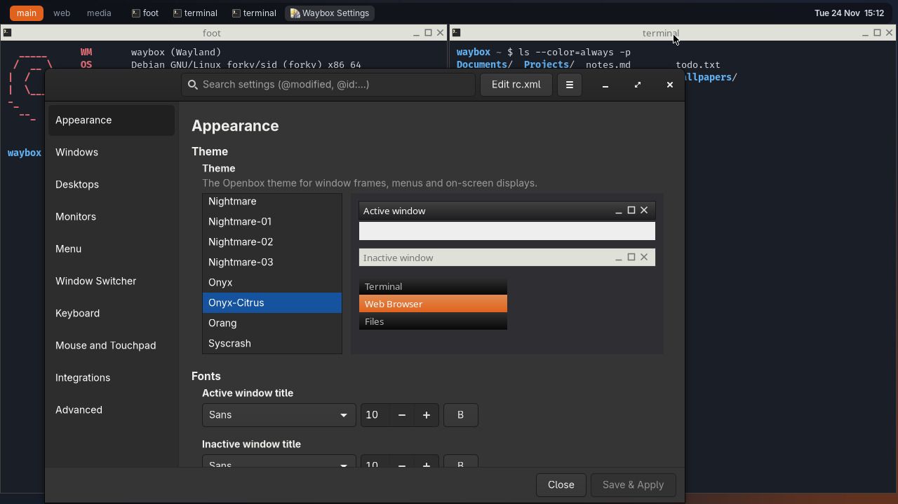
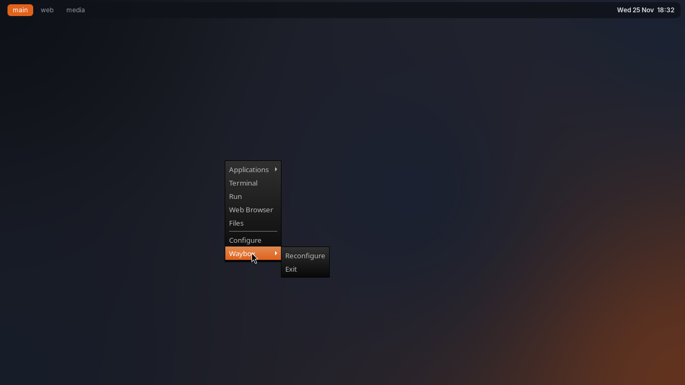
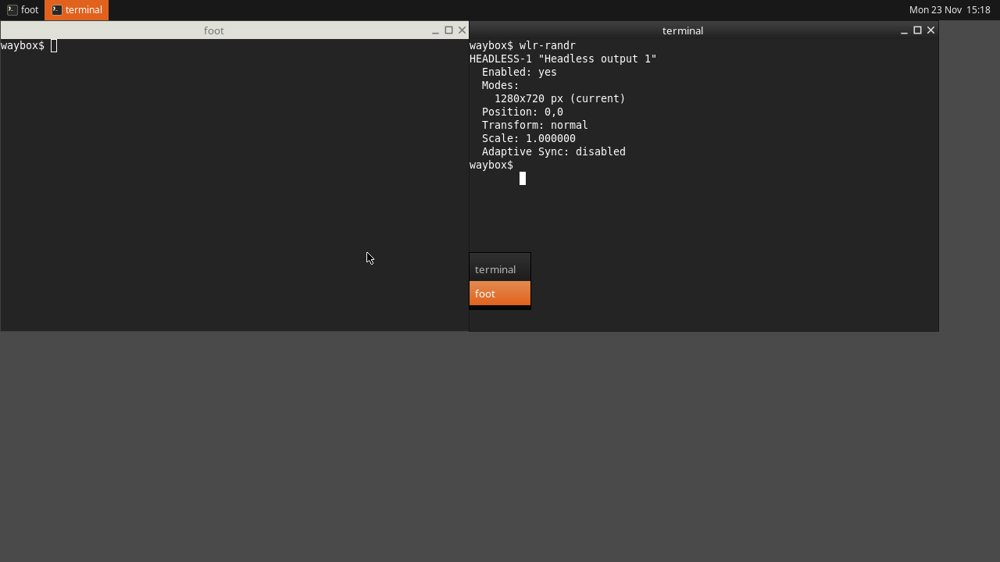

# Waybox

A \*box-style (minimalist) Wayland compositor modeled on Openbox.



This is the [TheCleaners](https://github.com/TheCleaners/waybox) fork of
[wizbright/waybox](https://github.com/wizbright/waybox). It began as a
crash-fixing pass and grew into a C++20 rework that adds a native root menu,
server-side decorations, Openbox theming, an Alt+Tab switcher and a settings
GUI. It still reads Openbox-style `rc.xml`, `menu.xml` and `themerc` files.
For background, see
[wizbright/waybox#48](https://github.com/wizbright/waybox/issues/48).

- [Features](#features)
- [Building](#building)
- [Running](#running)
- [Configuration](#configuration)
- [Screenshots](#screenshots)
- [Companion programs](#companion-programs)
- [Contributing](#contributing)

## Features

### Window management

- **Server-side decorations**: themed titlebars, borders and buttons, with
  resize cursors and grab borders. Client-side decorations are respected, and
  decorations can be toggled per window or set with an app rule.
- **Native root menu**: right-click the desktop. It is built from `menu.xml`,
  with submenus, pipe menus, icons and keyboard navigation. You can hand it off
  to an external launcher such as rofi instead.
- **Virtual desktops** as in Openbox: `<desktops>` in `rc.xml`, the
  `GoToDesktop`, `SendToDesktop` and `ToggleOmnipresent` actions
  (Ctrl+Alt+Left/Right, Shift+Alt+Left/Right and Super+F1–F4 by default),
  and a `<desktop>` app rule. Alt+Tab stays on the current desktop, and
  focusing a window from a taskbar goes to its desktop. Panels see and switch
  desktops through `ext-workspace-v1` (Waybar's `ext/workspaces` module).
- **X11 programs** through Xwayland, started on first use: Steam, Wine,
  older toolkits. X11 windows get the same frames, placement, desktops,
  focus and actions as Wayland ones; dialogs open centred over their parent,
  and menus and tooltips appear where the program puts them. Turn it off
  with `<xwayland enabled="no"/>`.
- **Window menu**: right-click a title bar or press Alt+Space to send the
  window to another desktop, minimize, maximize, move, resize, roll it up or
  close it.
- **Alt+Tab switcher** with an on-screen list, in most-recently-used order.
- **Openbox themes** (`themerc`) with per-place fonts.
- **Edge tiling**: drag a window to a monitor edge to tile it to the left or
  right half, a corner quarter, or maximized at the top, with a preview of
  where it goes. Dragging it away restores its size. Super+arrows do the
  same from the keyboard (`SnapToEdge`); `<waybox><edgeTiling>` turns it off.
- **Placement and snapping**: new windows open on the monitor with the
  pointer; Smart, Center or UnderMouse placement; snapping
  to edges and other windows; maximizing that respects panels; separate
  horizontal and vertical maximize; shading.
- **Bindings and rules**: Openbox key chains, mouse/context bindings,
  Alt+drag to move or resize, and per-application rules (position, size,
  state, focus, decorations, desktop).
- **Screen locking** with swaylock or any other `ext-session-lock-v1` locker.
  While locked, every output is covered, compositor bindings are off, and
  only the locker gets input. If the locker crashes, the screen stays locked
  and blank until a new locker unlocks it. The lock screen is opaque by
  design; for a blurred-desktop look, give swaylock a blurred screenshot
  (`grim - | magick - -blur 0x8 /tmp/lock.png && swaylock -i /tmp/lock.png`).
- **wbconf**: a GTK4 settings tool in the style of obconf, with a live theme
  preview.

### Protocols

| Area | Protocols |
|---|---|
| Displays | `wlr-output-management` (wlr-randr, kanshi), `wp-fractional-scale` (sharp text in foot and others at 1.25×, 1.5× and so on), `xdg-output`, `gamma-control` |
| Shell | `xdg-shell`, `xdg-decoration`, `layer-shell`, `xdg-activation`, `xdg-toplevel-icon` |
| Security | `ext-session-lock` (swaylock); virtual keyboard and pointer, ignored while locked by default (`<virtualInput>`) |
| Taskbars | `wlr-foreign-toplevel-management`, `ext-foreign-toplevel-list`, `ext-workspace` (desktops in Waybar) |
| Input | `pointer-constraints`, `relative-pointer` (pointer lock for games, held only while the window has keyboard focus) |
| Clipboard | `primary-selection`, `ext-data-control` |
| Capture | `ext-image-copy-capture` (grim, screen recorders), with whole outputs and single windows as sources (window capture needs wlroots 0.20) |
| X11 | Xwayland (lazy start, `DISPLAY` exported to the session) |
| Graphics | `linux-dmabuf` v4, `linux-drm-syncobj` (explicit sync, on the DRM backend) |
| Other | `presentation-time`, `viewporter`, `single-pixel-buffer`, `content-type`, `cursor-shape`, `idle-notify`, `idle-inhibit` |

### Robustness

The code is C++20, with RAII wrappers around wlroots listeners. Debug builds
run with AddressSanitizer and UndefinedBehaviorSanitizer. Unit tests and
headless integration tests run in CI.

## Building

You need Meson (or muon), a C++20 compiler and wlroots 0.19 or 0.20, plus
the libraries below. librsvg (SVG menu icons), GTK4 (wbconf) and Xwayland
(X11 programs, needed at run time only) are optional.

**Debian / Ubuntu**

```sh
sudo apt install meson ninja-build g++ pkg-config libwlroots-0.20-dev \
  libwayland-dev wayland-protocols libxkbcommon-dev libxml2-dev libevdev-dev \
  libinput-dev libcairo2-dev libpango1.0-dev librsvg2-dev libgtk-4-dev \
  xwayland
```

**Alpine**

```sh
apk add meson g++ wlroots-dev wayland-dev wayland-protocols libxkbcommon-dev \
  libxml2-dev libevdev-dev libinput-dev cairo-dev pango-dev xwayland
```

Then build and test:

```sh
meson setup build
ninja -C build
meson test -C build
```

| Option | Effect |
|---|---|
| `-Dbuildtype=release` | Optimized build. Sanitizers are on by default only for debug builds. |
| `-Dsanitize=enabled\|disabled` | Force ASan and UBSan on or off. |
| `-Dwlroots-version=0.19` | Pick a specific wlroots when several are installed. |
| `-Dsvg=disabled`, `-Dwbconf=disabled` | Skip the optional pieces. |
| `-Dman-pages=disabled`, `-Dinfo=disabled` | Skip the manual pages (scdoc) or the Texinfo manual (makeinfo). |
| `-Dtests_only=true` | Build only the unit tests, which don't need wlroots. |

## Running

`ninja -C build install` installs a `waybox` session script and a
`waybox.desktop` session entry. Start `waybox` from a TTY, or choose Waybox
in your display manager. To try it inside another Wayland session without
installing, run `build/waybox/waybox`.

Default bindings (from [`data/rc.xml`](data/rc.xml)):

| Binding | Action |
|---|---|
| Right-click desktop | Root menu |
| <kbd>Alt</kbd>+<kbd>Tab</kbd> / <kbd>Alt</kbd>+<kbd>Shift</kbd>+<kbd>Tab</kbd> | Next / previous window |
| <kbd>Alt</kbd>+left-drag / right-drag | Move / resize window |
| <kbd>Alt</kbd>+<kbd>F4</kbd> | Close window |
| <kbd>Super</kbd>+<kbd>M</kbd> / <kbd>Super</kbd>+<kbd>Shift</kbd>+<kbd>M</kbd> | Iconify / toggle maximize |
| <kbd>F11</kbd> | Fullscreen |
| <kbd>Super</kbd>+<kbd>S</kbd> / <kbd>Super</kbd>+<kbd>Shift</kbd>+<kbd>S</kbd> | Shade / unshade |
| <kbd>Super</kbd>+<kbd>T</kbd> | Toggle decorations |
| <kbd>Super</kbd>+<kbd>Return</kbd> | Terminal (`$TERMINAL`) |
| <kbd>Alt</kbd>+<kbd>F2</kbd> | Launcher (`rofi -show drun`) |
| <kbd>Print</kbd> | Screenshot (grim) |
| <kbd>Super</kbd>+<kbd>C</kbd> | Reload configuration |
| <kbd>Ctrl</kbd>+<kbd>Escape</kbd> | Exit Waybox |

### Multiple GPUs

Waybox drives displays on every GPU and draws the desktop on the first one
it opens. To choose the GPUs, or their order, set `WLR_DRM_DEVICES` (e.g.
`/dev/dri/card0:/dev/dri/card1`) in `~/.config/waybox/environment`.

## Configuration

Waybox reads `rc.xml`, `menu.xml`, `environment` and `autostart` from
`$XDG_CONFIG_HOME/waybox/` (normally `~/.config/waybox/`). For any file not
found there, it uses the system copy in `<sysconfdir>/xdg/waybox/`, which is
installed from [`data/`](data). The session script falls back to Openbox's
files if it finds no Waybox ones.

The format follows Openbox. A `<waybox>` block holds settings specific to this
fork: menu behaviour, switcher options and titlebar sizing. The shipped
[`rc.xml`](data/rc.xml) is commented throughout. To edit settings in a GUI,
run `wbconf` or open it from the root menu.

## Screenshots

Shown with the Onyx-Citrus Openbox theme. The tour and these stills come
from [`tools/record-tour.py`](tools/record-tour.py), which runs a private
headless Waybox, drives it with `wlrctl` and `wtype`, and captures it with
`grim`. Run it again after UI changes; `--theme` picks another theme.



| Root menu | Alt+Tab switcher |
|---|---|
|  |  |

## Companion programs

Like Openbox, Waybox leaves most desktop functions to separate programs.

| Purpose | Programs |
|---|---|
| Panel | [Waybar](https://github.com/Alexays/Waybar), [yambar](https://codeberg.org/dnkl/yambar) |
| Dock | [Cairo-Dock](https://github.com/dkondor/cairo-dock-core/) (Wayland port), [LavaLauncher](https://sr.ht/~leon_plickat/LavaLauncher/) |
| Wallpaper | [swaybg](https://github.com/swaywm/swaybg), [wpaperd](https://github.com/danyspin97/wpaperd), [hyprpaper](https://github.com/hyprwm/hyprpaper) |
| Displays | [wlr-randr](https://sr.ht/~emersion/wlr-randr/), [kanshi](https://sr.ht/~emersion/kanshi/) (profiles) |
| Launcher | [rofi-wayland](https://github.com/lbonn/rofi) or any dmenu-like tool |
| Notifications | [mako](https://wayland.emersion.fr/mako/) |
| Password prompts | a polkit agent, e.g. KDE's, GNOME's or [lxqt-policykit](https://github.com/lxqt/lxqt-policykit); the default `autostart` starts the first one installed |
| Clipboard | [wl-clipboard](https://github.com/bugaevc/wl-clipboard) |
| Screenshots | [grim](https://git.sr.ht/~emersion/grim) + [slurp](https://github.com/emersion/slurp) |
| Screen recording | [wf-recorder](https://github.com/ammen99/wf-recorder) |

## Contributing

Issues and pull requests are welcome at
[TheCleaners/waybox](https://github.com/TheCleaners/waybox). Maintenance time is
limited, so a focused PR with a test is the easiest thing to merge. See
[CONTRIBUTING.md](CONTRIBUTING.md).

## Credits

[@wizbright](https://github.com/wizbright) created Waybox.
[@keithbowes](https://github.com/keithbowes) did much of the later wlroots
porting and protocol work. The original lives at
[wizbright/waybox](https://github.com/wizbright/waybox).
