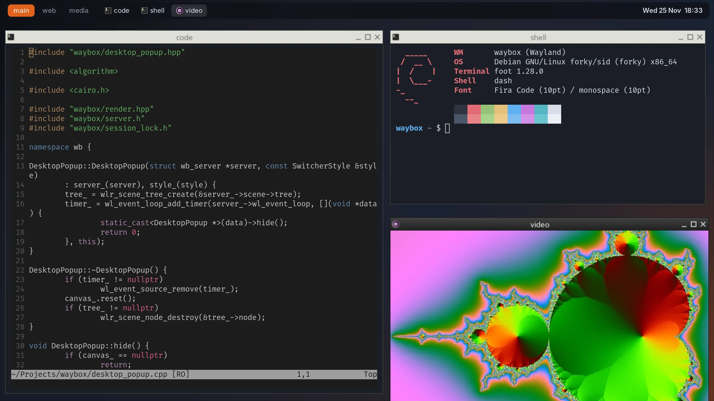
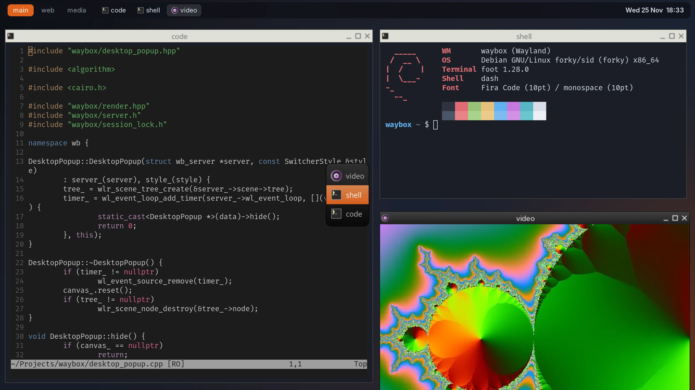
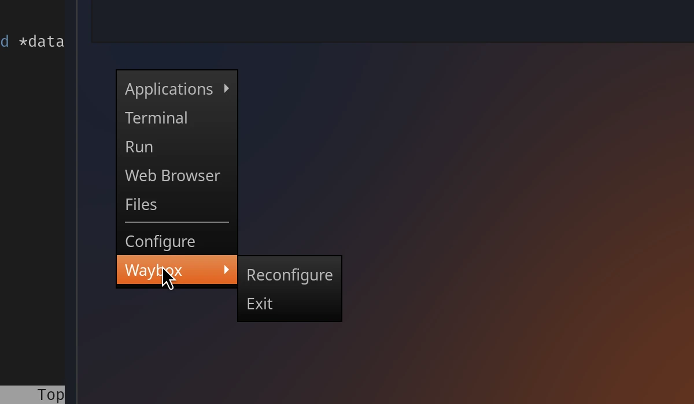
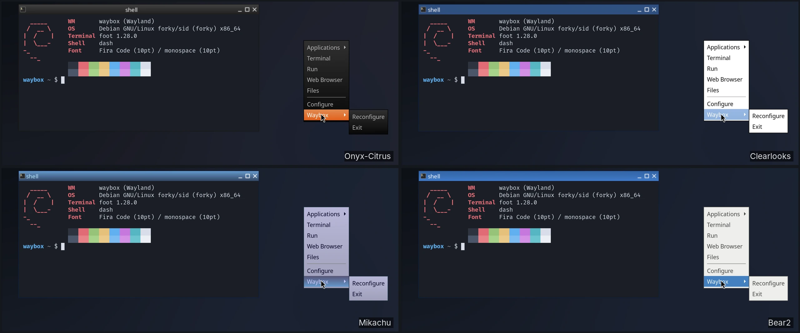
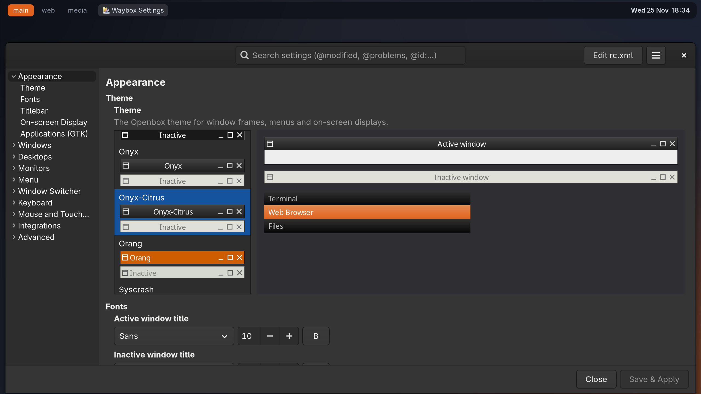
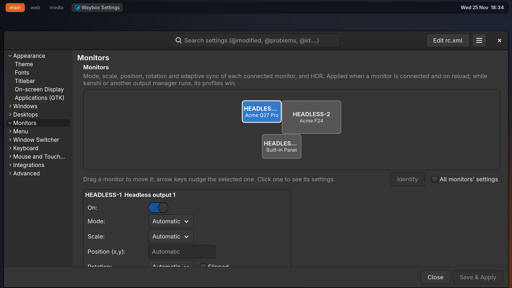

# Gallery

Waybox in a few setups, shot at 2560×1440 (a 1280×720 desktop at scale 2).
Everything shown is made up for the shot: the home folder, its files, the
video. `tools/record-tour.py --gallery` takes them all again (at releases:
git keeps every version of each image).

## An everyday desktop

Code on the left, a shell and a video on the right, Waybar on top; the
Onyx-Citrus theme.

## Alt+Tab

The window switcher, with each window's icon, over the same desktop.

## The root menu

Right-click the desktop; submenus open on hover.

## Openbox themes

The same terminal and menu in four Openbox themes, as they come.

## wbconf

Every setting in one list, sections in the sidebar, a live preview of the
theme.

Monitors arranged by dragging, here two side by side and a laptop's panel
under them.

